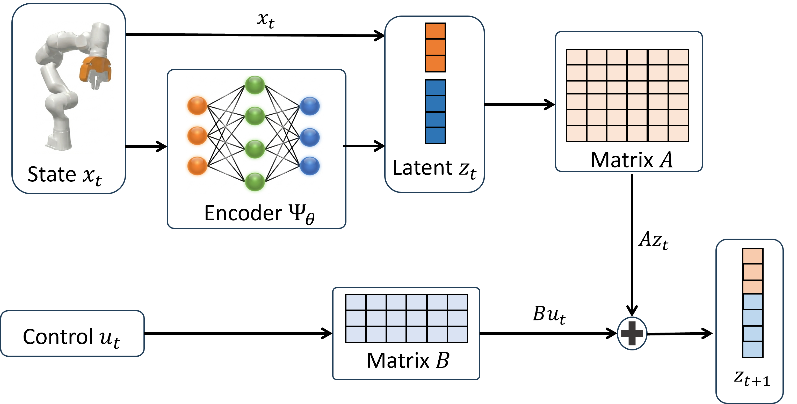

# Scaling Law of Neural Koopman Operators

Abulikemu Abuduweili, Yuyang Pang, Feihan Li, Changliu Liu. [Scaling Law of Neural Koopman Operators](https://arxiv.org/abs/2602.19943), *arXiv preprint*, 2026 · [Project page](https://intelligent-control-lab.github.io/Koopman-Scaling/)

## Introduction

A neural Koopman model lifts nonlinear dynamics $x_{t+1} = f(x_t, u_t)$ into a learned latent space where the evolution is linear: an encoder maps the state to $z = \Phi_\theta(x) = [x; \Psi_\theta(x)]$, and $z_{t+1} = A z_t + B u_t$. The linear structure makes model predictive control (MPC) a quadratic problem with a closed-form solution. **How much data does a given latent dimension need, and how should data and model capacity be scaled together?** This repository contains the code of our finite-sample analysis experiments and of the neural Koopman experiments on six systems: a damped pendulum, a double pendulum, a Franka arm, real data of a Kinova Gen3 arm, a Unitree Go2 quadruped, and a Unitree G1 humanoid.

<p align="center">
  
</p>

## Data–Capacity Scaling Law

The error of predicting the state with an $n$-dimensional latent space estimated from $m$ samples splits into a **sampling** term and a **projection** term:

$$
\epsilon(n, m) \;\lesssim\; \sqrt{\frac{\kappa_n \log n}{m}} \;+\; n^{-\beta},
\qquad \text{when } m \gtrsim \kappa_n \log n .
$$

- $\kappa_n = \sup_s \Phi(s)^\top G_n^{-1}\Phi(s) \ge n$ is the *leverage constant* of the latent space. It depends on the observable space, not on its basis. For well-spread features, $\kappa_n = O(n)$.
- $\beta$ is the rate at which the latent space approximates the observables of interest and their one-step images.

Consequences:

- **Sufficient sample size.** The bound holds once $m \gtrsim \kappa_n \log n$, a worst-case sufficient scale.
- **Coupled scaling.** For well-spread features, $m = c \cdot n \log n$ keeps the sampling term at $O(c^{-1/2})$ for every $n$.
- **Best latent dimension for a data budget.** The bound is minimized at $n^\star \asymp (m/\log m)^{1/(1+2\beta)}$; much larger latent spaces predict worse with little data.

## Training Losses

- **Multi-step prediction loss**: discounted MSE of the physical state over a $T$-step latent rollout.
- **Covariance loss**: penalizes the off-diagonal entries of the covariance of the learned features $\Psi_\theta(x)$.
- **Inverse-control loss**: recovers $u_t$ from consecutive latent states, $\hat u_t = (B^\top B)^{\dagger} B^\top (z_{t+1} - A z_t)$, so that latent transitions keep information about the applied inputs.

## Installation

Python >= 3.9 and PyTorch >= 1.12:

```bash
pip install -r requirements.txt
```

Optional: [PyBullet](https://pybullet.org) for the Franka environment (included in `requirements.txt`), and [Isaac Lab](https://isaac-sim.github.io/IsaacLab/) for the G1/Go2 closed-loop evaluation in `control/mpc_tracking.py`.

## Data

The pendulum and Franka (PyBullet) datasets are generated on the fly. The other environments read recorded data from `data/`:

```
data/g1_flat/{initial_dataset,tracking_dataset}/*.npz          # Unitree G1 (Isaac Lab)
data/unitree_go2_flat/{initial_dataset,tracking_dataset}/*.npz # Unitree Go2 (Isaac Lab)
data/kinova_data/output_*.txt                                  # Kinova Gen3 recordings
```

Generated datasets are cached in `data/datasets/`. Portable caches (`*.cache.npz`) can be converted into training caches with `python scripts/convert_dataset_cache.py`. Each training sample is a trajectory segment of 15 transitions, and the train/validation/test split uses a fixed seed. For Kinova, segments are cut from consecutive rows of each recording and split chronologically, with gaps so that no time step is shared between splits.

## Training

```bash
cd scripts
python train_model.py \
  --project_name demo \
  --env_name DampingPendulum \
  --sample_size 16000 \
  --encode_dim 4 \
  --multiply_encode_by_input_dim \
  --layer_depth 3 \
  --hidden_dim 256 \
  --seed 17382 \
  --use_residual \
  --use_control_loss \
  --use_covariance_loss
```

Environments: `DampingPendulum`, `DoublePendulum`, `Franka`, `FrankaImproved`, `Kinova`, `G1`, `Go2`. With `--multiply_encode_by_input_dim`, the encoder outputs `encode_dim × state_dim` features, which are concatenated with the state. Each run saves its best checkpoint to `log/<project>/best_models/` and appends one row (including `test_Kloss`) to `log/<project>/koopman_results_log.csv`.

## Experiments

All scripts are run from `scripts/` and write to `log/`. Sharded scripts accept `SHARD=i NSHARDS=k` to split a sweep over several machines, and `PARALLEL` / `NGPU` to run several trainings at once.

**Scaling laws (Figs. 2–4, Table 2).**

- `run_experiments.sh`: data size × latent dimension × loss sweep (skips runs that are already logged).
- `kinova_sweep.py`: the same grid on the Kinova data.
- `run_corr_experiments.sh`: coupled schedule $m = c \cdot n_\text{enc} \log n_\text{enc}$ on G1 and Go2.
- `plot_scaling_laws.py --logs ../log/*/koopman_results_log.csv --out ../log/figures [--bootstrap 300]`: figures and fitted exponents with seed-bootstrap intervals.

**Fixed-feature test of the theory (Fig. 5, Table 3).** `bash run_fixed_feature_study.sh` runs the whole pipeline on a CPU or a single GPU:

1. `train_one_encoder.py`: trains the frozen pendulum encoders (five seeds, six latent sizes);
2. `make_reference_pool.py`: simulates an independent reference pool;
3. `fixed_feature_study.py`: least-squares fits on $m$ independent transitions; records sampling and projection errors and the event $\|\tilde G_{n,m} - I\| \le 1/2$;
4. `threshold_law_fits.py`: censored-likelihood fits of the sample-threshold laws and leave-one-seed-out prediction;
5. `plot_fixed_feature_study.py`: the three panels of Fig. 5.

**Representation diagnostics (Appendix).** `leverage_diagnostics.py FEATURES.npy` reports the Gram spectrum, numerical rank, condition number, and estimated leverage of any learned feature matrix (the project page has the same tool in the browser). `measure_leverage.py` and `measure_leverage_robot.py` estimate the leverage constant and the Gram spectrum of learned features. `regularizer_diagnostics.py` (G1/Go2) and `kinova_diagnostics.py` (Kinova) report input recoverability, conditioning, and prediction loss of the four training variants. `kinova_aux_sweep.py` trains the Kinova variants.

**Closed-loop control.**

- *G1 / Go2 (Isaac Lab, GPU).* `run_aux_tuning.sh select`, `select_aux_config.py`, and `run_aux_tuning.sh final` select the training length, loss weights, and MPC input weight on validation reference trajectories (1000–1499), with the same candidates for the baseline, and evaluate the full grid on the test trajectories (0–999). `analyse_aux_final.py` summarizes the results. `control/mpc_tracking.py` is the tracking evaluator.
- *Baselines.* `baseline_comparison.py` trains the EDMD and NNDM baselines and reports their prediction error. `run_baseline_control.sh` runs their closed-loop evaluation on G1/Go2.
- *Franka (PyBullet).* `franka_tune.py` and `select_franka_config.py` train the model grid. `franka_mpc_grid.py` evaluates every model with a grid of MPC settings on the star (validation) and figure-8 (test) trajectories. `analyse_franka_mpc_grid.py` selects the settings on the star trajectory only.

**Project page.** `export_page_demo.py` exports the pendulum models of the interactive demos, and `export_fig5c_web.py` exports the data of the interactive Fig. 5c (`docs/assets/`).

## Repository Structure

```
scripts/                      # Training, experiments, analysis, and figures (see above)
  train_model.py              # Training entry point
  plot_style.py               # Shared figure style
utility/
  dataset.py                  # Data collectors for all environments and the train/val/test split
  network.py                  # KoopmanNet (state-retaining encoder + linear latent dynamics)
  franka_env.py               # PyBullet Franka environment
  kinova_lcm/                 # Kinova Gen3 data-collection stack
control/
  mpc_core.py                 # Linear MPC (closed-form solution of the unconstrained problem, then clipping)
  mpc_tracking.py             # Isaac Lab tracking evaluation for G1/Go2
  baselines.py                # EDMD and NNDM baselines for G1/Go2
  franka_mpc.py               # Franka trajectory-tracking MPC
  baseline_control/           # EDMD and NNDM controllers for Franka
docs/                         # Project page (GitHub Pages)
figs/                         # README figures
```

## Citation

```bibtex
@article{abuduweili2026scaling,
  title={Scaling Law of Neural Koopman Operators},
  author={Abuduweili, Abulikemu and Pang, Yuyang and Li, Feihan and Liu, Changliu},
  journal={arXiv preprint arXiv:2602.19943},
  year={2026}
}
```

## License

This code is released under the [MIT License](LICENSE).
