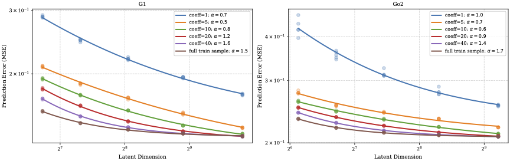

# Scaling Law of Neural Koopman Operators

Abulikemu Abuduweili, Yuyang Pang, Feihan Li, Changliu Liu, [Scaling Law of Neural Koopman Operators](https://arxiv.org/abs/2602.19943),
*arXiv preprint*, 2026 · [Project page](https://intelligent-control-lab.github.io/Koopman-Scaling/)

## Introduction

A neural Koopman model lifts nonlinear dynamics $x_{t+1} = f(x_t, u_t)$ into a learned latent space where the evolution is linear: an encoder maps the state to $z = \Phi_\theta(x) = [x, \Psi_\theta(x)]$ so that $z_{t+1} = Az_t + Bu_t$. This enables linear control (LQR, MPC) for nonlinear robots. **How much data does a given latent dimension need, and how should data and model capacity be scaled together?** We answer this with a finite-sample analysis and experiments on pendulums, robot arms, a quadruped, and a humanoid.

<p align="center">
  
</p>

## Data–Capacity Scaling Law

The error of predicting the state with an $n$-dimensional latent space estimated from $m$ samples splits into a **sampling** term and a **projection** term:

$$
\epsilon(n, m) \;\lesssim\; \sqrt{\frac{\kappa_n \ln n}{m}} \;+\; n^{-\beta},
\qquad \text{valid once } m \gtrsim \kappa_n \ln n .
$$

- $\kappa_n = \sup_s \Phi(s)^\top G_n^{-1}\Phi(s) \ge n$ is the *leverage constant* of the latent space. It depends on the subspace, not on how the features are parameterized. For well-spread features, $\kappa_n = O(n)$.
- $\beta$ is the rate at which the latent space can represent the next-state map. It is small for non-smooth, high-dimensional (contact-rich) dynamics.

Consequences:

- **Stability threshold.** Reliable estimation needs at least $m \gtrsim n \ln n$ samples.
- **Coupled scaling.** Scaling the data as $m = c \cdot n \ln n$ keeps the sampling term at $O(c^{-1/2})$ for every $n$. The coefficient $c$ sets the data-sufficiency level.
- **Best latent dimension for a data budget.** The bound is minimized at $n^\star \asymp (m/\ln m)^{1/(1+2\beta)}$. Much larger latent spaces overfit, which is what we observe on G1 and Go2 in the low-data regime.

<p align="center">
  
</p>

## Training Losses

- **Multi-step prediction loss**: discounted MSE of the physical state over a $K$-step latent rollout.
- **Inverse control loss**: reconstructs $u_t$ from consecutive latent states with the pseudo-inverse of $B$, so that the latent transitions keep information about the applied inputs.
- **Covariance loss**: penalizes off-diagonal entries of the covariance of the learned features, which decorrelates them and improves their conditioning.

## Installation

Requirements: Python >= 3.8, PyTorch >= 1.12, NumPy, SciPy, pandas, tqdm. Optional: PyBullet (Franka environment) and Isaac Lab (G1/Go2 MPC evaluation).

```bash
pip install torch numpy scipy pandas tqdm
pip install pybullet   # only for the Franka environment
```

## Data

The pendulum, polynomial, and Franka (PyBullet) datasets are generated on the fly. The other environments read recorded data from `data/`:

```
data/g1_flat/{initial_dataset,tracking_dataset}/*.npz          # Unitree G1 (Isaac Lab)
data/unitree_go2_flat/{initial_dataset,tracking_dataset}/*.npz # Unitree Go2 (Isaac Lab)
data/kinova_data/output_*.txt                                  # Kinova Gen3 recordings
```

Generated datasets are cached in `data/datasets/`. The train/validation/test split uses a fixed seed (42). For Kinova, windows are built from consecutive rows of each recording, and the split is chronological with a gap between blocks, so no time step is shared between splits.

## Usage

Train a Koopman model:

```bash
cd scripts
python train_model.py \
  --project_name demo \
  --env_name DampingPendulum \
  --sample_size 16000 \
  --encode_dim 4 \
  --multiply_encode_by_input_dim \
  --layer_depth 3 \
  --hidden_dim 256 \
  --seed 17382 \
  --use_residual \
  --use_control_loss \
  --use_covariance_loss
```

Environments: `DampingPendulum`, `DoublePendulum`, `Franka`, `Kinova`, `G1`, `Go2`, `Polynomial`, `LogisticMap`. With `--multiply_encode_by_input_dim`, the encoder outputs `encode_dim × state_dim` features, which are concatenated with the state.

Models are saved to `log/<project>/best_models/`, and every run appends one row (including `test_Kloss`) to `log/<project>/koopman_results_log.csv`. Sweeps:

- `scripts/run_experiments.sh`: data-size × latent-dimension × loss sweep (skips runs that are already logged).
- `scripts/run_corr_experiments.sh`: coupled $m = c \cdot n \ln n$ sweeps on G1/Go2.
- `scripts/run_kinova_v3_both.sh`: Kinova sweep with the corrected windows.

Controlled pendulum study (paper Sec. 6.1.4 and appendix; runs on a CPU in about an hour):

- `scripts/export_page_demo.py --grid`: data-size × latent-size grid; (A, B) refit by least squares on each model's own data.
- `scripts/split_study.py`: the same grid with five seeds, plus a sample-split fit of (A, B) on disjoint windows. Writes `log/split_study.csv`.
- `scripts/measure_leverage.py`: estimates the leverage constant κ_n of the controlled-study models.

Auxiliary-loss tuning for G1/Go2 (needs Isaac Lab and a GPU): `scripts/run_aux_tuning.sh` selects the training steps, loss weights, and MPC input weight on validation reference trajectories (1000-1499), with the same budget for the baseline, then runs the full sweep on the test trajectories (0-999). See the header of the script for the protocol.

The evaluation notebooks in `evaluation/` produce the paper figures from these logs.

## Repository Structure

```
scripts/
  train_model.py              # Training entry point
  run_experiments.sh          # Data-size x latent-dimension sweep
  run_corr_experiments.sh     # Coupled m = c n ln n sweep for G1/Go2
  run_kinova_v*.sh            # Kinova sweeps
  export_page_demo.py         # Pendulum demo and grid models for the project page
  split_study.py              # Five-seed, sample-split controlled study
  measure_leverage.py         # Leverage constant of the grid models
utility/
  dataset.py                  # Data collectors for all environments and the train/val/test split
  network.py                  # KoopmanNet (state-retaining encoder + linear latent dynamics)
control/
  mpc_tracking.py             # Isaac Lab MPC tracking evaluation for G1/Go2
evaluation/                   # Notebooks for prediction, tracking, and scaling analysis
docs/                         # Project page (GitHub Pages)
figs/                         # Figures
```

## Citation

```bibtex
@article{abuduweili2026scaling,
  title={Scaling Law of Neural Koopman Operators},
  author={Abuduweili, Abulikemu and Pang, Yuyang and Li, Feihan and Liu, Changliu},
  journal={arXiv preprint arXiv:2602.19943},
  year={2026}
}
```

## License

This code is released under the [MIT License](LICENSE).
